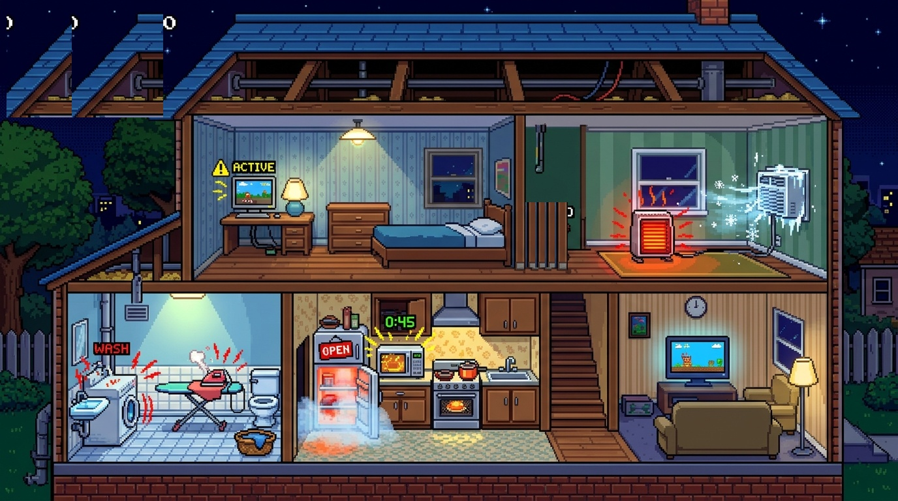

# ⚡ Detectives de la Energía

> **Videojuego 2D Pixel Art para navegador** enfocado en la concientización del ahorro y uso responsable de la energía eléctrica en el hogar.



---

## 📖 Sinopsis del Juego

Es una noche caótica: alguien ha dejado múltiples artefactos encendidos en la casa y la red eléctrica está al borde del colapso. La temperatura de la llave térmica no para de subir y, si supera el límite de sobrecarga, ¡saltará la térmica y la casa quedará a oscuras!

Tu misión como **Detective de la Energía** es recorrer las habitaciones, identificar los artefactos que derrochan electricidad (desde los de consumo alto hasta los de consumo excesivo) y apagarlos o desenchufarlos a tiempo. Pero ten cuidado: ¡a veces algún habitante de la casa puede volver a encenderlos a tus espaldas!

---

## 🎮 Características Principales

* **Estilo Retro Pixel Art 16-Bit**: Gráficos generados con IA con estética retro, corte transversal de dos niveles (dormitorio, cocina, sala, lavadero y altillo).
* **Audio Sintetizado 8-Bits**: Efectos de pasos, pitidos de radar, chispazos, sirenas de sobrecarga y fanfarrias de victoria sintetizados con la **Web Audio API** (sin necesidad de archivos externos).
* **Mecánica de Re-encendido Dinámico**: En medio de la partida, los artefactos pueden volverse a prender repentinamente acompañados de alertas visuales y sacudidas de pantalla.
* **Dos Modos de Dificultad**:
  * 🟢 **Modo Fácil**: 1 minuto (60 segundos) con sobrecarga moderada para planificar tus movimientos.
  * 🔴 **Modo Difícil**: 30 segundos a contrarreloj con sobrecarga acelerada y multiplicador de puntos doble (**x2 pts**).
* **Pausa al Inspeccionar**: Al abrir la tarjeta de cualquier electrodoméstico, el tiempo se detiene para que puedas leer cómodamente sus especificaciones y consejos de ahorro.
* **100% Responsive**: Se adapta dinámicamente a monitores de computadora, portátiles y pantallas táctiles de tablets/móviles.

---

## 🕹️ Controles

| Acción | Teclado | Táctil / Ratón |
| :--- | :--- | :--- |
| **Moverse a los lados** | Teclas `◄` `►` o `A` / `D` | Botones `◄` `►` o clic en el suelo |
| **Subir / Bajar Escaleras** | Teclas `▲` `▼` o `W` / `S` | Botones `▲` `▼` en la escalera |
| **Escanear / Apagar** | `ESPACIO`, `E` o `Enter` | Botón **ACCIÓN** o clic directo sobre el artefacto |
| **Pausar lectura** | Clic en cualquier artefacto | Tocar directamente el artefacto |

---

## ⚡ Escala de Consumo de los Artefactos

| Artefacto | Potencia (Watts) | Categoría | Impacto y Consejo |
| :--- | :---: | :---: | :--- |
| **Aire Acondicionado a 17°C** | `2.200 W` | 🔴 Excesivo | En verano fijar el termostato a 24°C para optimizar hasta un 30%. |
| **Estufa Radiante Eléctrica** | `2.000 W` | 🔴 Excesivo | La generación de calor por resistencia directa es uno de los mayores derroches. |
| **Anafe / Cocina Eléctrica** | `2.000 W` | 🔴 Excesivo | Tapa las ollas para cocinar más rápido y aprovecha el calor residual. |
| **Plancha a Vapor** | `1.800 W` | 🔴 Excesivo | Plancha toda la ropa en una sola tanda para no calentar la resistencia varias veces. |
| **Horno Microondas** | `1.400 W` | 🟠 Alto | Muy potente puntualmente; evitar mantenerlo en consumo fantasma continuo. |
| **Lavarropas (Agua Caliente)** | `1.200 W` | 🟠 Alto | El 80% de la energía se va en calentar el agua; lavar en frío ahorra gran cantidad de energía. |
| **Heladera con Puerta Abierta** | `500 W` | 🟠 Alto | El motor compresor trabaja sin descanso tratando de enfriar toda la casa. |
| **Computadora Gamer** | `450 W` | 🟡 Medio | Activar el modo de suspensión automática si te alejas por más de 15 minutos. |
| **Televisor en Standby** | `250 W` | 🟡 Medio | El consumo fantasma suma hasta un 10% de la factura eléctrica anual. |
| **Lámpara Incandescente** | `100 W` | 🟡 Medio | Desperdicia un 90% en calor y solo 10% en luz. Reemplazar por bombillas LED. |

---

## 🚀 Cómo Ejecutar Localmente

No requiere Node.js, compilación ni dependencias pesadas.

1. Clona el repositorio:
   ```bash
   git clone https://github.com/roquegimenez/detectives-de-la-energia.git
   cd detectives-de-la-energia
   ```
2. Inicia un servidor web local sencillo (por ejemplo con Python):
   ```bash
   python -m http.server 8080
   ```
3. Abre tu navegador en `http://localhost:8080` (o abre directamente el archivo `index.html`).

---

## 🛠️ Tecnologías Utilizadas

* **HTML5 Canvas**: Renderizado 2D pixel art con spritesheets y partículas.
* **JavaScript ES6+**: Motor de física, lógica de estados, ciclo de vida del juego y detector de colisiones.
* **Web Audio API**: Generación procedural de efectos de sonido en 8 bits en tiempo real.
* **CSS3**: Diseño responsive con flexbox, CSS grid, variables y tipografía retro (`Press Start 2P`, `VT323`).
* **Inteligencia Artificial**: Creación de recursos visuales y spritesheets temáticos.
